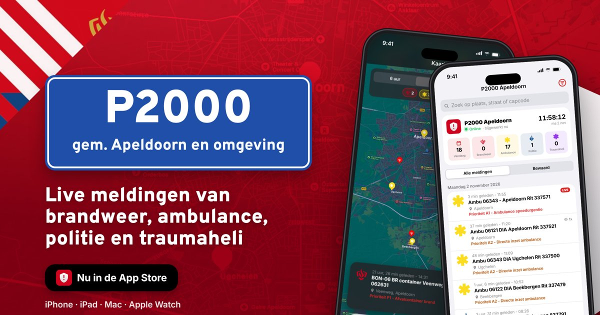
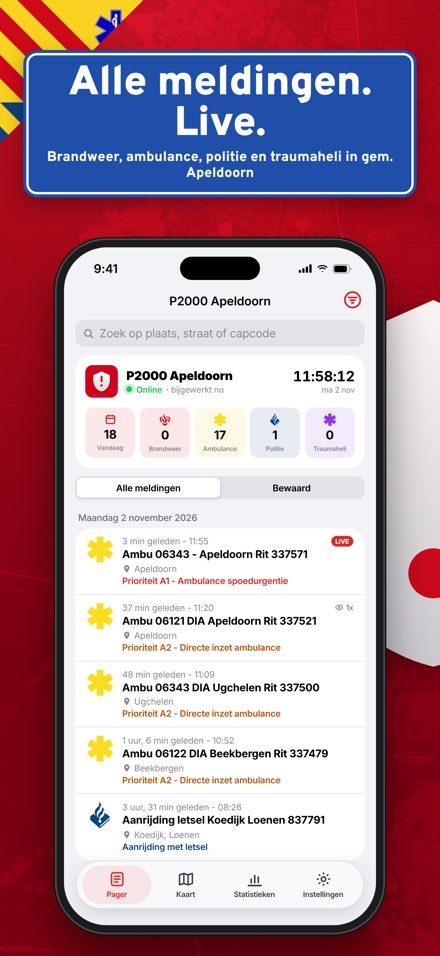
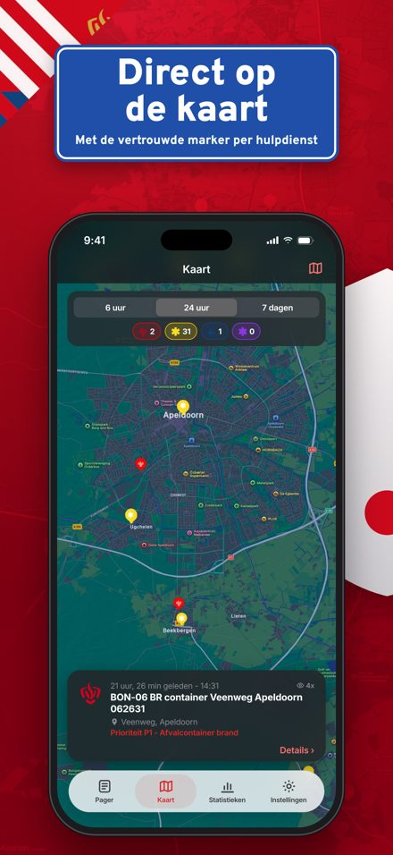
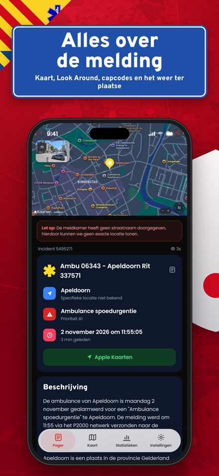
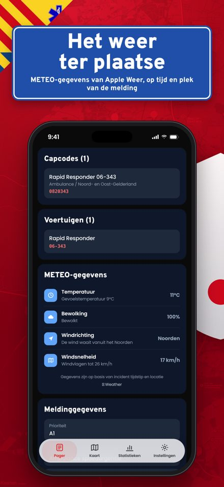
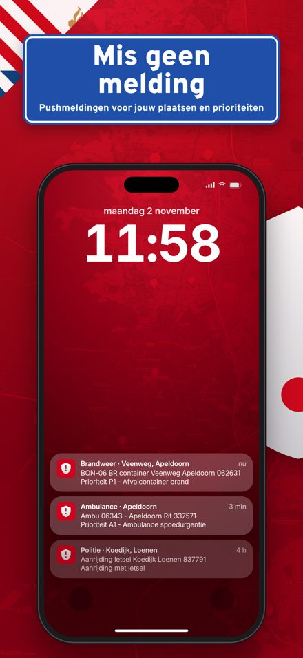
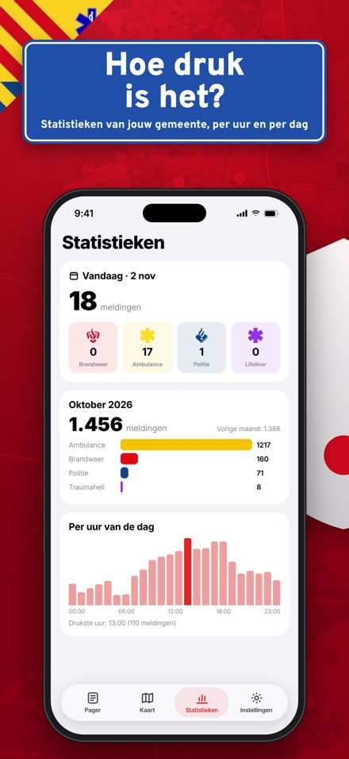
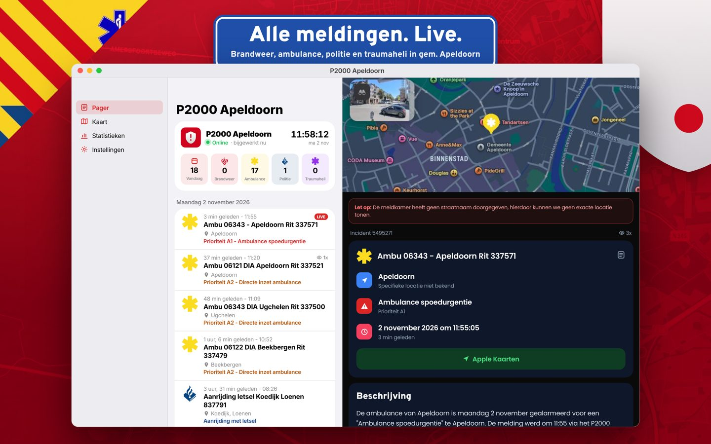

# A-Alerts – Apple apps



De app van [a-alerts.nl](https://a-alerts.nl) voor **iPhone, iPad, Mac, Apple Watch en Apple TV**. Je ziet alle P2000-meldingen van brandweer, ambulance, politie en traumaheli in de gemeente Apeldoorn en Teuge, met NL-Alert, Burgernet, KNMI-waarschuwingen en live helikopters: live, op de kaart en met statistieken.

| | |
|---|---|
| Bundle ID | `nl.lrvdlinden.p2000apeldoorn` (watch: `…​.watchkitapp`) |
| Versie | 1.0.0 (build 8) |
| Platforms | iOS/iPadOS 18+, macOS 15+, watchOS 11+, tvOS 18+ |
| Talen | Nederlands (bron), Engels |
| Team | EU3UY476T6 |

## Nieuws

Tabblad Nieuws (iPhone, iPad, Mac, Apple Watch, Apple TV, Android en a-alerts.nl/nieuws): politieberichten (bron politie.nl), 112 Nieuws (titel en intro, met toestemming), liveblogs bij Burgernet, AMBER Alert en Vermist Kind Alert, een artikel bij elke Burgernet-oproep, AMBER Alert, Vermist Kind Alert en NL-Alert, en een weerartikel bij elke KNMI-waarschuwing. In beheer zet je per artikel de schakelaar Liveblog aan (standaard uit): dan staat er "Liveblog" bij, LIVEBLOG op de afbeelding en valt het onder het filter Liveblogs. Een weerartikel is opgebouwd zoals de waarschuwing op knmi.nl: kaart van heel Nederland met de gebieden in hun code en het tijdvenster ("maandag 23:30 tot dinsdag 12:00"), de kop van het KNMI, de code, de uitleg, de uitgiftetijd, Risico's en advies en de details. Eén artikel per code: zolang de code gelijk blijft volgt het artikel de waarschuwing; een nieuwe code (hoger, lager of opgeheven/code groen) geeft een nieuw artikel en het vorige blijft zoals het was.

## Verkeer

Kaartlaag **Verkeer** (iPhone, iPad, Mac, Apple TV, Android, a-alerts.nl pager en meldkamer): afsluitingen en werkzaamheden, ongevallen en pech, en files met vertraging in de regio Apeldoorn, uit de open data van de NDW (`actueel_beeld.xml.gz`: Rijkswaterstaat, provincie en gemeenten), met straatnamen via de PDOK Locatieserver. Laag **Flitsers**: vaste flitsers en trajectcontroles uit OpenStreetMap (mobiele controles staan in geen enkele open bron). Het NDW-bestand is te groot voor de Worker (CPU-limiet), daarom leest de aparte service [a-alerts_file_verkeer_info](https://github.com/LRvdLinden/a-alerts_file_verkeer_info) op Koyeb (gratis) het bestand en vraagt de Worker elke minuut het kleine resultaat op (`GET /v1/verkeer`). Secrets van de Worker: `VERKEER_URL` en `VERKEER_TOKEN`; zonder die secrets is de laag leeg.

**Widgets (alleen website):** op a-alerts.nl/nieuws staan rechts (op de telefoon onder het nieuws) de widgets **Live kaart** (vierkant: gemeentegrens in de kleur van de KNMI-code, verkeer, P2000 van de laatste 3 uur, helikopters in het gebied, ziekenhuizen, buien, optioneel flitsers; licht/donker automatisch) en **Verkeer nu** (opgebouwd als een verkeerssite: tegels met het aantal files met km, werk, afsluitingen, ongevallen en flitsers; Nu / Gepland / Flitsers; groepen per weg met wegschild (A rood, N geel) en per plaats; per melding de rijrichting "Apeldoorn → Amersfoort", het traject, wat er is in kleur, tot wanneer en de hinder; tik voor oorzaak en bron; in de lijst alleen ronde iconen). Derde widget **Weer**: de KNMI-waarschuwing voor Apeldoorn e.o. met de afbeelding van het weerartikel, titel, code en korte tekst; *Meer informatie* klapt uitgifte, tijdvakken, Risico's en advies en Details open, met de knop naar het artikel; meerdere waarschuwingen als regels eronder; anders Code groen. Alle links in de widgets gaan naar a-alerts.nl (verkeer en flitsers: `/pager/?verkeer=<id>#kaart` opent de melding op de kaart). Andere websites plaatsen elke widget met een eigen script: `<script src="https://a-alerts.nl/widget/kaart.js|verkeer.js|weer.js" data-thema="auto" async></script>`; de widget verschijnt op de plek van het script in een iframe die meegroeit en niet aan te passen is (`embed.js` blijft werken voor oude plaatsingen). Handleiding: `docs/A-Alerts-widgets.pdf`, ook op `a-alerts.nl/widget/A-Alerts-widgets.pdf`; de naam A-Alerts staat in elke kop en onderaan. De widget meldt de domeinnaam (`GET /v1/widget/ping`); in beheer (Widgets) staat de code om te kopiëren, de lijst van sites met weergaven, en blokkeren.

## Functies

- **Animated splash**: het schild valt in beeld, pager-pulsen golven uit en daarna gaat de app open.
- **Welkomstscherm** met pushmeldingen en *Inloggen met Apple*. Inloggen is optioneel.
- **Pager**: de live tijdlijn zoals op de site. Meldingen zijn per dag gegroepeerd, met een live klok en een online-status, en de cijfers van vandaag per discipline. Je kunt zoeken en filteren (disciplines, plaatsen, prioriteit). Meldingen kun je bewaren of delen, en op iPad en Mac staat de detailweergave ernaast (split view).
- **Detail**: dezelfde opbouw als a-alerts.nl/melding/…. Bovenaan een grote kaart met marker en een **Look Around**-preview. Daaronder de *Let op*-melding als er geen straat is, het incidentnummer en de views, en een hoofdkaart met plaats, categorie, prioriteit en tijd. Er is alleen een **Apple Kaarten**-knop. Verder: Beschrijving, Capcodes, Voertuigen, **METEO-gegevens via WeatherKit** (historisch weer per uur, op het tijdstip en de plek van de melding) en Meldinggegevens.
- **Kaart**: Apple Maps met de **markers van de website** (brandweer, ambulance, politie, traumaheli). Je filtert op periode (6 uur, 24 uur, 7 dagen) en discipline. Meldingen op dezelfde plek worden net als op de site in een cirkel gezet.
- **Hectometerpaal en adres-markers**: een melding met een hectometerpaal in de titel (bijvoorbeeld "A50 Re 211,2") staat op die paal op de kaart (PDOK, het wegenbestand van Rijkswaterstaat) en toont bij de locatie het groene hectometerbordje. Meerdere meldingen op één adres staan samen op één marker met het aantal erboven: traumahelikopter bovenop, anders politie, anders de dienst met de meeste meldingen.
- **Homey-app** (`homey/`): de A-Alerts-app voor Homey (SDK 3), met de Flow-kaarten en de kant-en-klare berichten. Het echte `env.json` (webhook-ID en -secret) staat er niet in en wordt door git genegeerd; `env.json.example` laat zien wat erin hoort. `node_modules` staat er ook niet in: draai `npm install` in `homey/`.
- **Alles wat vliegt** (build 93, `worker/src/vliegend.js`): waar een toestel op de grond staat, meerdere helikopters op één plek, een gewijzigde roepnaam, de status per toestel en weer dat vliegen beperkt (`GET /v1/helikopters/status`), een eigen geluid en "Klopt dit toestel niet?" (`POST /v1/helikopters/<id>/melden`).
- **Posten, bel en kaart** (build 92): cijfers per kazerne (`GET /v1/posten/<id>`, tabel `post_inzet`), pushmelding bij landen en terugvlucht van een gevolgd toestel, opschaling in het verloop, kaartlaag met de grens van de veiligheidsregio (`GET /v1/veiligheidsregio`), een keuze van het app-icoon op iPhone en iPad, en een mededeling van de makers die je in beheer bij Teksten zet (`GET /v1/app`).
- **Inzet op de server** (build 91): de worker koppelt meldingen van dezelfde inzet bij binnenkomst (`incident` op elke melding, `GET /v1/meldingen/<guid>/verloop`), zodat app, Android en site hetzelfde verloop tonen. Van iedere melding komt nog steeds een pushmelding. `GET /v1/app` geeft de minimale build (`MIN_BUILD_IOS`, `MIN_BUILD_ANDROID` in `worker/wrangler.toml`).
- **Toestelkaart, bel en inzet** (build 85): tik op een helikopter of vliegtuig en je ziet boven welke plaats het vliegt, hoe lang het in de lucht is en waar het is geweest, met hoogte in meters en voet, snelheid in km/u en knopen en een kompasje. Met de bel krijg je een pushmelding zodra dat toestel opstijgt. Bij een melding staan alle eenheden van dezelfde inzet met de tijd van alarmering, en bij een brandmelding met huisnummer het bouwjaar en gebruik van het gebouw (BAG, via PDOK: `GET /v1/meldingen/<guid>/pand`). Kaartlagen staan per categorie. De plaatsnamen komen uit `worker/src/woonplaatsen.js` (PDOK, gemaakt door `tools/geodata/fetch_woonplaatsen.py`).
- **Kaartlaag Luchtvaart** (iPhone, iPad, Mac, Apple TV, Android, pager en meldkamer; één laag, bij Kaartlagen kies je per soort toestel wat je ziet, standaard Lifeliner en Zulu; routespoor en vluchten van twee uur voor elk toestel): helikopters en vliegtuigen van Defensie, de Kustwacht, de Koninklijke Marechaussee en het regeringsvliegtuig PH-GOV boven Nederland, met een eigen tekening per type (Chinook, Apache, Cougar, NH90, F-35, Hercules, lesvliegtuig, Dash-8, AW189 …). Bron: adsb.lol (ODbL), via `GET /v1/lucht`. Een toestel wordt herkend aan zijn vaste toesteladres en type; de roepnaam is alleen een label en mag per vlucht wisselen. Staat de laag aan en vliegt er iets, dan staat er een pill "Defensie" met het aantal.
- **a-alerts.nl/luchtvaart** (alleen website): uitleg per toestel met de eigen tekeningen, en op de homepage het blok "Zie wat er boven je vliegt" met een bewegende kaart. Opnieuw maken na een wijziging: `python3 tools/maak_luchtvaart.py` (bronnen in `tools/lucht/*.svg`).
- **Statistieken**: vandaag tegenover gisteren: totaal (ook "gisteren om deze tijd"), per discipline, per uur, per prioriteit en de meest voorkomende meldingen. De app rekent dit zelf uit; er worden alleen deze twee dagen bijgehouden.
- **Instellingen**: account, notificaties (plaatsen, disciplines, prioriteit, stille modus, kritieke meldingen), filters, huidige locatie, donkere modus, kaarttype, app-vergrendeling met Face ID/Touch ID, recensie, feedback, changelog, voorwaarden, privacy, disclaimer en de kaart **Meer apps van de ontwikkelaar** (in alle talen).
- **iCloud-sync**: instellingen en bewaarde meldingen worden via iCloud key-value storage gelijkgehouden op iPhone, iPad, Mac en Watch.
- **Review-prompt**: de eerste keer 4 uur na het eerste gebruik op dat apparaat, daarna hoogstens één keer per week. Hij verschijnt alleen op een rustig moment: een paar seconden na het openen, en nooit tijdens de splash, het welkomstscherm of als de app vergrendeld is.
- **Apple Watch**: de laatste meldingen, een detailscherm met kaart en de tellingen van vandaag.
- **Apple TV (meldkamer)**: live kaart die zelf langs de meldingen gaat, de laatste meldingen, een grote klok en de tellingen van vandaag. Nieuwe meldingen verschijnen met een alarmscherm (altijd of alleen bij spoed). Detail met 3D-kaart, capcodes en het weer, statistieken vandaag vs. gisteren. Het scherm blijft aan. Zelfde bundle ID als de iPhone-app (universal purchase).

## Screenshots

<p>   </p>
<p>  </p>

## Lettertypen

De app gebruikt het standaard Apple-lettertype (SF Pro) en schaalt mee met de systeemtekstgrootte.

## Architectuur: geen server, wel 24/7

```
p2000.page-feed ──► Cloudflare Worker (cron elke minuut, 3× uitlezen) + D1-database ──► REST-API ──► app · widgets · website
                                   │
                                   └──► Apple Push Notification service (APNs) ──► pushmeldingen
```

Er is geen server om te beheren: de API draait als **Cloudflare Worker** (`worker/`), gratis binnen het Workers Free-plan. De sleutel van p2000.page en de Apple-sleutels staan alleen als secrets bij de Worker; ze komen uit je GitHub-secrets.

### worker/
- Een cron-trigger draait elke minuut en leest de p2000.page-feed 3× per minuut. Alleen meldingen uit de gemeente Apeldoorn worden bewaard (3 dagen, `RETENTION_DAYS`).
- Per melding: prioriteit, categorie, capcodes, voertuigen en coördinaten (straten via de Apple Maps Server API).
- Endpoints:
  - `GET /v1/meldingen` en `GET /v1/meldingen/:guid`, `POST /v1/meldingen/:guid/view`
  - `GET /v1/meldingen/:guid/weather` (WeatherKit) en `GET /v1/mapkit-token`
  - `GET /v1/content/privacy|terms|disclaimer` en `GET /v1/changelog`
  - `GET /v1/verkeer`: verkeer (NDW) en vaste flitsers (OSM) in de regio, van de verkeersservice op Koyeb
  - `POST /v1/devices`, `DELETE /v1/devices/:token`, `POST /v1/devices/:token/test`
  - `POST /v1/broadcast` met `Authorization: Bearer ADMIN_TOKEN`
- Pushmeldingen gaan rechtstreeks naar APNs en houden rekening met plaatsen, disciplines, prioriteiten, stille modus, kritieke meldingen en de radius. Het gratis plan staat 50 uitgaande verzoeken per cron-run toe; meer pushes dan dat gaan via een wachtrij (`outbox`) mee met de volgende minuut. Met Workers Paid ($5 per maand) is die limiet veel hoger.
- Bij een lege database worden eenmalig de laatste 400 meldingen van vandaag en gisteren van de oude website overgenomen (`BACKFILL`).
- Testen: `cd worker && npm test`. Lokaal draaien: `npm run dev`.

### Eenmalig instellen
1. Maak een gratis account op [dash.cloudflare.com](https://dash.cloudflare.com).
2. **Account ID**: staat rechts op de overzichtspagina van *Workers & Pages*. Zet hem in GitHub als secret `CLOUDFLARE_ACCOUNT_ID`.
3. **API-token**: *My Profile → API Tokens → Create Token → template "Edit Cloudflare Workers"*, en voeg de permissie **Account → D1 → Edit** toe. Zet hem in GitHub als secret `CLOUDFLARE_API_TOKEN`.
4. Start in GitHub **Actions → Worker → Run workflow**. De workflow maakt de D1-database, zet alle secrets over en deployt. In de samenvatting staat het adres (`https://p2000-apeldoorn-api.<jouw-naam>.workers.dev`).
5. Controleer `<adres>/health`: `"feed"` moet een recente `lastOk` hebben.
6. Eigen adres (optioneel): niet nodig: de API blijft bewust op het workers.dev-adres, ook na de overstap naar a-alerts.nl.

Bij elke push naar `worker/` test en deployt de workflow opnieuw.

## Website (`website/`)

Een statische website voor je **eigen hosting**, zonder build-stap:

- `/` – de homepage over de app, met animaties, live tellingen en een ticker met de laatste meldingen.
- `/pager/` – de **live pager** in je browser: tijdlijn (24 uur), filters, Mijn buurt, kaart (MapKit JS met de eigen markers), meldingdetail met Look Around en METEO (WeatherKit), en statistieken vandaag vs. gisteren. Geopende meldingen worden grijs.
- `/info/?p=privacy|terms|disclaimer` – de teksten uit `worker/content`.
- Oude links `/melding/<guid>` worden doorgestuurd naar `/pager/?melding=<guid>` (via `.htaccess` op Apache-hosting, of `404.html`).

**Uploaden:** bij elke wijziging maakt de workflow *Website-zip* een kant-en-klare zip (Actions → Website-zip → Artifacts). Upload de inhoud naar de webmap van je domein (`public_html`), inclusief het verborgen bestand `.htaccess`.

`config.js` bevat het API-adres. Het MapKit JS-token haalt de site zelf op bij de Worker (`/v1/mapkit-token`), voor de domeinen in `SITE_ORIGINS` (standaard a-alerts.nl, www, beheer.a-alerts.nl en de oude p2000-apeldoorn.nl).

Lokaal bekijken: `cd website && python3 -m http.server 8000` en open http://localhost:8000.

### Apple-sleutels voor de Worker
De workflow *Worker* zet deze GitHub-secrets automatisch over:

| Secret | Waarvoor |
|---|---|
| `P2000_PAGE_API_URL` | De bron van de meldingen |
| `APN_KEY_ID`, `APN_TEAM_ID`, `APN_P8_CERT` | Pushmeldingen |
| `WEB_WEATHERKIT_KEY_ID`, `WEB_WEATHERKIT_TEAM_ID`, `WEB_WEATHERKIT_P8` | METEO per melding (gecachet) |
| `MAPS_SERVER_API_KEY_ID`, `MAPS_SERVER_API_TEAM_ID`, `MAPS_SERVER_API_P8` | Straatnamen omzetten naar precieze coördinaten |
| `WEB_MAPKIT_JS_KEY_ID`, `WEB_MAPKIT_JS_TEAM_ID`, `WEB_MAPKIT_JS_P8` | `GET /v1/mapkit-token` (reserve voor de website) |

WeatherKit heeft ook een **Services ID** nodig (Identifiers → Services IDs, met WeatherKit aan). Standaard is dat `nl.lrvdlinden.p2000apeldoorn.weatherkit`; een andere naam zet je in `worker/wrangler.toml` bij `WEB_WEATHERKIT_SERVICE_ID`.

`/health` laat zien welke diensten actief zijn (`apns`, `mapkit`, `weatherkit`, `mapsServer`).

## Pushmeldingen in de app
- iPhone, iPad en Mac gebruiken echte APNs-pushmeldingen. De Apple Watch krijgt de meldingen van de iPhone mee.
- Debug-builds gebruiken APNs-sandbox. TestFlight- en App Store-builds gebruiken productie.
- Tik je op een melding, dan opent de app die melding. Dat werkt via `guid` in de payload.

## Mijn buurt (radius)
Bij Instellingen → **Mijn buurt** kies je een straal van 0,5 tot 25 km rond **je locatie** of een **vast punt**. Een vast punt kies je door op de kaart te tikken of een adres te zoeken. De straal geldt voor de lijst, de kaart (met een cirkel), de widgets én de pushmeldingen.

## Tijdlijn
- De Pager toont alleen de meldingen van de laatste **24 uur**.
- Meldingen die je al hebt geopend worden **grijs**. Met *Verberg bekeken meldingen* zie je ze niet meer.

## Bouwen

1. Open `P2000Apeldoorn.xcodeproj` in Xcode 16 of nieuwer. De mappen zijn gesynchroniseerd, dus nieuwe bestanden komen er vanzelf in.
2. Kies het scheme **P2000 Apeldoorn** en als bestemming een iPhone, iPad, *My Mac* of een Apple Watch. De Watch-app wordt automatisch in de iOS-app ingebed.
3. Zet in de Developer-portal bij de App ID's deze capabilities aan: **Sign in with Apple**, **Push Notifications** (ook *Time Sensitive Notifications*), **iCloud (Key-value storage)**, **App Groups** (`group.nl.lrvdlinden.p2000apeldoorn`) en **WeatherKit** (ook onder *Services*). Doe dat ook voor de widget- en Watch-App ID's (App Groups en iCloud). Met automatische signing doet Xcode dit meestal zelf.

Teksten vertaal je in `tools/en.json`. Met `python3 tools/make_strings.py` maak je daarna `Shared/Localizable.xcstrings` opnieuw. Het projectbestand maak je opnieuw met `python3 tools/make_project.py`.

## Structuur

```
P2000Apeldoorn/        iOS · iPadOS · macOS (App, Services, Views, Assets)
P2000ApeldoornWatch/   watchOS-app
P2000ApeldoornTV/      tvOS-app (meldkamer)
Shared/                modellen, API's, store, instellingen, splash, gedeelde UI, strings
Config/                xcconfig, Info.plist's, entitlements
tools/                 generators voor strings, projectbestand en website-config
website/               de website + live pager (GitHub Pages)
worker/                API, ingest, pushmeldingen, WeatherKit/Maps (Cloudflare Worker + D1)
```

© 2026 A-Alerts. Made & Powered by [PixelForges](https://pixelforges.nl). Bron: [p2000.page](https://p2000.page).
